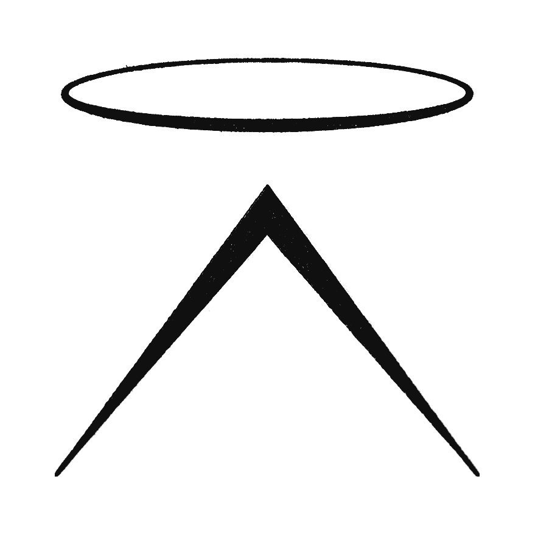

<p align="center">
  <a href="https://aaenz.no">
    <picture>
      <source media="(prefers-color-scheme: dark)" srcset="public/assets/logo-mark-light.png">
      
    </picture>
  </a>
</p>

<h1 align="center">aaenz.no</h1>

<p align="center">The website of Aaen Studios.</p>

<p align="center">
  <a href="https://calxlang.com">算 CALX</a> 〜
  <a href="https://calcitemc.com">晶 CALCITE</a> 〜
  <a href="https://loom.rip">織 LOOM</a> 〜
  <a href="https://aaenz.no/minecraft">星 STELLAR</a>
</p>

<p align="center">
  <a href="https://aaenz.no">
    
  </a>
</p>

## Plates

Drawn by [`engine.ts`](components/ascii/engine.ts) from [`programs.ts`](components/ascii/programs.ts).

| Plate | Glyphs | On |
|---|---|---|
| `hero` | 光 翼 羽 天 | home |
| `octagon` | 壁 人 | home |
| `spindle` | 式 算 解 | Calx |
| `frontier` | 砂 草 森 山 人 | Calcite |
| `rays` | 目 田 口 光 | home |
| `world` | 草 土 石 鉄 人 | Minecraft |
| `weave` | 使 読 書 消 | loom |
| `vortex` | 核 機 | kern |
| `river` | 音 映 詠 唱 | galdr |
| `orb` | 読 語 字 | yomion |
| `stream` | 言 語 人 | contact |
| `stars` | 星 | Stellar |
| `strata` | 草 基 土 盤 | Armature |
| `quests` | 章 任 条 報 | Tenet |
| `clouds` | 雲 人 | /minecraft |
| `shore` | 星 骨 身 肉 | footer |
| `kanji` | 無 空 虚 | 404 |
| `current` | 〜 ︴ | background |

<p align="center">
  <a href="https://aaenz.no/minecraft">
    
  </a>
</p>

## Running it

```sh
bun install
bun run dev
```

## Environment

All optional, in `.env.local`.

| Variable | For |
|---|---|
| `RESEND_API_KEY`, `CONTACT_TO_EMAIL`, `CONTACT_FROM_EMAIL` | Contact form |
| `NEXT_PUBLIC_CONTACT_EMAIL` | Email shown on the page |
| `CURSEFORGE_API_KEY` | Download count |

## Layout

| Folder | |
|---|---|
| [`app/`](app/) | Pages, share cards, API routes |
| [`components/ascii/`](components/ascii/) | Plate engine and plates |
| [`components/`](components/) | Header, footer, cursor, scroll rail, contact form |
| [`lib/`](lib/) | Stellar mods, share-card helpers |
| [`public/assets/`](public/assets/) | Logo and source images ([prompts](prompts.md)) |
| [`docs/`](docs/) | Specs and research notes |

Design rules: [STYLE.md](STYLE.md). A push to `master` deploys aaenz.no.

<p align="center"><sub>AAEN STUDIOS ・ © MMXXVI</sub></p>
